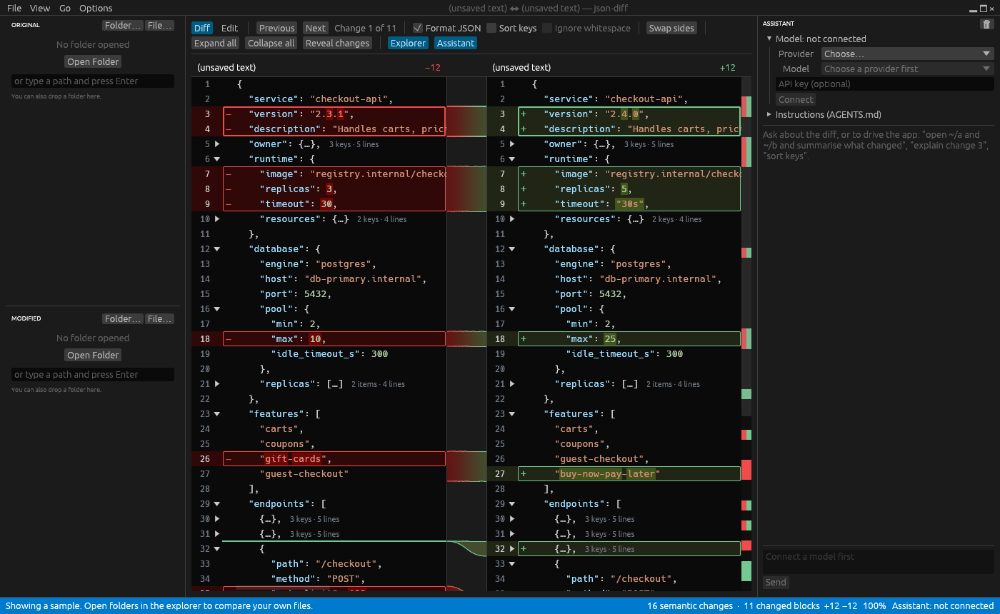

# json-diff

Authored by Omkar Mohanty.

An app for comparing JSON documents side by side, in the style of VS Code's diff
editor. It is built for large files: documents open folded to their top-level keys, and
changes are found by meaning rather than by line, so reformatting and key order don't
show up as noise. It runs on Windows and Linux, and in the browser.



## Features

- **Side-by-side diff.** Changed lines are red on the original side and green on the
  modified side, with the changed characters highlighted. Ribbons connect each change
  to where it belongs on the other side. Drag the ribbon gutter to give either side
  more room; double-click it to split evenly again.
- **Tree view.** An overview of what changed: both documents as one tree of keys, with
  only the paths to changes listed. A changed value reads `old → new`, added and removed
  keys are green and red, and each object or array shows how many changes it holds. It
  starts folded to the top-level keys; **Reveal changes** opens every path to a change,
  and **Show unchanged** lists everything else too.
- **Structural comparison.** Changes are matched by JSON structure, not line position.
  Records in an array are paired by similarity, so a record inserted next to an edited
  one shows as one addition and one edit, not two edits.
- **Folding for large files.** Documents open with only their top-level keys showing. A
  folded key that hides changes is coloured, and **Reveal changes** opens just the
  paths that lead to them.
- **Ignore keys.** Right-click a key in the diff to ignore its changes: just that key,
  or every key with its name (handy for timestamps). Ignored changes leave the diff,
  the change count, the assistant's answers and PDF reports, and folders whose files
  differ only in ignored keys count as identical. The **N ignored** button in the
  toolbar lists them and counts them again. They are remembered between runs.
- **Folder comparison.** Open two folders, original and modified, in the split
  explorer. Files with the same relative path are paired and marked modified (M), only
  in the original (D) or only in the modified folder (A).
- **Options.** Format JSON, sort keys, ignore whitespace, swap sides, and an edit mode
  for pasting or editing text.
- **AI assistant (optional).** Ask what changed, or have it drive the app: open
  folders, step through changes, expand keys. It works with any provider supported by
  [rig](https://github.com/0xPlaygrounds/rig): OpenAI, Anthropic, Gemini, Mistral,
  OpenRouter, Ollama and others. It also follows [AGENTS.md](https://agents.md)
  instructions found next to your files.

## Install

### In your browser

Open **[ultra-infinity.github.io/json-diffrs](https://ultra-infinity.github.io/json-diffrs/)**:
nothing to install. Open two files with **Open original…** and **Open modified…**, or
drop them on the page. The comparison runs inside the page, so your files never leave
your computer.

The web app has the same diff, folding, ignored keys and PDF export, which downloads
the report. It compares single files only, not folders, and has no assistant. Your
settings and ignored keys are kept in that browser.

### Windows

Download `json-diff-<version>-x86_64.msi` from the
[latest release](https://github.com/ultra-infinity/json-diffrs/releases/latest) and run
it. The installer adds a Start menu shortcut and puts `json-diff` on your `PATH`.

json-diff draws its window with Microsoft Edge WebView2, which comes with Windows 11
and is kept up to date on Windows 10. If json-diff says it "could not find the WebView2
Runtime", install it from [Microsoft](https://developer.microsoft.com/microsoft-edge/webview2/).

json-diff checks for a new version when it starts, and **Help → Check for Updates…**
checks on demand. When there is one, a bar at the top offers **Update now**: the new
installer is downloaded, its signature checked, and installed in place. Open json-diff
again once the installer finishes. **What's new** in the bar lists the changes before
you install, and the first start after an update shows them again. **Help → What's
New** lists every release's changes ([CHANGELOG.md](CHANGELOG.md)).

On Linux the same bar tells you about new versions; update with your package manager,
for example `nix profile upgrade json-diff`.

### NixOS and Nix

Run it without installing:

```sh
nix run github:ultra-infinity/json-diffrs
```

To install it on NixOS, add the flake to your system flake's inputs:

```nix
inputs.json-diff.url = "github:ultra-infinity/json-diffrs";
```

and add the package to your configuration:

```nix
environment.systemPackages = [ inputs.json-diff.packages.${pkgs.system}.default ];
```

This also adds a launcher entry, so you can select two `.json` files in your file
manager and open them with json-diff.

### From source

You need a recent Rust toolchain (Rust 2024 edition) and Node.js 22. On Linux you also
need the GTK 3 and WebKitGTK 4.1 development libraries (`nix develop` provides all of
this).

```sh
(cd ui && npm ci && npm run build)
cargo build --release -p json-diff --features custom-protocol
./target/release/json-diff
```

## Usage

```sh
json-diff                                # opens with a sample comparison
json-diff original.json modified.json    # compare two files
json-diff old-configs/ new-configs/      # compare two folders
```

You can also open folders and files with the explorer's **Folder…** and **File…**
buttons, or type a path and press Enter. Folders and files can also be dragged in:
a folder dropped on the top or bottom half of the explorer opens there, and a file
opens on the side of the window it lands on.

| Key | Action |
| --- | --- |
| F7 / Alt+↓ | Next change |
| Shift+F7 / Alt+↑ | Previous change |
| F5 | Refresh folders |
| ↑ ↓ PageUp PageDown Ctrl+Home Ctrl+End | Move through the diff (click into it first) |
| ← → / Shift+wheel | Scroll sideways |

**Diff**, **Tree** and **Edit** at the left of the toolbar switch between the line diff
(where json-diff opens), the tree of changes and two editors.

Click the arrow beside a line number to fold or unfold a key. **Expand all**,
**Collapse all** and **Reveal changes** in the toolbar act on the whole document.

### Export as PDF

**File → Export as PDF…** saves the comparison for people who don't have json-diff:

- **First, a summary:** every change, listed by JSON pointer, with its original and
  new value.
- **Then the side-by-side diff,** in red and green, with 3 lines of context around
  each change. You can choose 10 lines or the whole documents instead.
- **Paper:** US Letter or A4.

The report always includes everything, whatever is folded on screen, except changes to
ignored keys; its first page lists the ignored keys and how many changes they hid.

## The assistant

1. Open the **Assistant** panel.
2. Pick a **Provider**, then a **Model**. Type in the model list to search it, e.g.
   `gpt`. Choose **Other…** for a model that isn't listed, such as one you've pulled
   into Ollama.
3. Enter an API key, or leave the field empty to use the provider's usual environment
   variable. The field shows its name, e.g. `$OPENAI_API_KEY`. Local providers such as
   Ollama don't need a key.
4. Click **Connect**.

With **Remember this key** ticked, the key is kept in your system keychain (Windows
Credential Manager, or GNOME Keyring or KWallet on Linux) and used whenever you pick
that provider again. json-diff never writes keys to a file of its own. **Forget it**
removes a saved key. Without a keychain (some minimal Linux setups), keys simply
aren't remembered.

json-diff also remembers the provider and model, and reconnects to them when it
starts. To choose the model from outside instead, set `JSON_DIFF_MODEL`, for example
`JSON_DIFF_MODEL=openai:gpt-5.5`.

The assistant leaves out changes to ignored keys as well, and tells you when it has.

Every tool call the assistant makes is shown in the panel as it happens. It can open
files and change the view, but it can't modify or delete anything on disk. It can
export a PDF only when you ask for one, and you choose where it goes in the save
dialog. Your API key is only sent to the provider you pick.

### AGENTS.md

If the folders or files you open contain an `AGENTS.md`, the assistant follows it. Use
it to explain your data to the assistant, e.g. "version bumps are expected" or "ignore
the `metadata` key". The **Instructions (AGENTS.md)** section of the panel lists the
files in use:

- **In an opened folder:** every `AGENTS.md` from the folder's root down to the file
  being compared. The closest one takes precedence.
- **For a file opened on its own:** every `AGENTS.md` from its folder up to the root of
  its git repository.
- **Your own files:** **Add AGENTS.md…** lets you pick any Markdown file.

Untick a file to stop using it. Only open folders you trust: an `AGENTS.md` in them
becomes part of the assistant's instructions.

## Development

json-diff is a Rust app with a React + TypeScript frontend that shows the documents in
two [Monaco](https://microsoft.github.io/monaco-editor/) editors. The desktop app is
built with [Tauri](https://tauri.app); the web app runs the same Rust code compiled to
WebAssembly.

- [`crates/json-diff-core`](crates/json-diff-core): UI-independent diffing. It
  contains the structural diff (addressed by JSON pointer), the side-by-side line
  alignment, folding, ignored keys and folder pairing.
- [`crates/json-diff-app`](crates/json-diff-app): the app without a window, shared by
  both apps. It holds the app state and its commands, PDF reports, settings, and
  [`view.rs`](crates/json-diff-app/src/view.rs), the snapshot the frontend draws.
- [`crates/json-diff`](crates/json-diff): the desktop app (Tauri). It adds the window,
  files and folders on disk, the assistant, the keychain and the updater.
- [`crates/json-diff-web`](crates/json-diff-web): the web app's WebAssembly module.
- [`ui`](ui): the frontend. It keeps no state of its own: it draws the latest snapshot
  (line colours, changed characters, folds and how the two sides line up all come from
  Rust) and sends every click back to Rust. It reaches Rust through
  [`ui/src/backend`](ui/src/backend): Tauri for the desktop app, the WebAssembly module
  for the web app, chosen when it is built.

Settings (theme, zoom, panels, diff options, ignored keys, panel widths, the assistant's model) are
saved to `settings.json` in the OS config folder (`~/.config/io.github.ultra-infinity.json-diff`
on Linux, `%APPDATA%\io.github.ultra-infinity.json-diff` on Windows).

Every button and menu item calls the backend's `run` command with the name of one of
the assistant's tools, so the app and the assistant can always do the same things. A
new action therefore needs a `Command` in [`state.rs`](crates/json-diff-app/src/state.rs),
a matching tool in [`tools.rs`](crates/json-diff-app/src/tools.rs), and a button that calls
it through `run`. Both apps then have it.

```sh
nix develop              # Rust, Node, the Tauri CLI and the GTK/WebKit libraries
(cd ui && npm ci)
cargo tauri dev          # the app, with the frontend reloading as you edit it
cargo test --workspace
cargo clippy --workspace --all-targets -- --deny warnings
(cd ui && npm test && npm run typecheck)
```

The web app, served at http://localhost:1420:

```sh
nix develop -c scripts/build-wasm.sh    # again after changing Rust code
(cd ui && npm run dev:web)
```

With Nix:

| Command | Builds |
| --- | --- |
| `nix build` | The Linux package |
| `nix build .#frontend` | The frontend on its own |
| `nix build .#windows` | `json-diff.exe` and `WebView2Loader.dll`, cross-compiled from Linux |
| `nix build .#msi` | The Windows installer ([`main.wxs`](crates/json-diff/wix/main.wxs)) |
| `nix build .#web` | The web app: a folder of static files to serve from anywhere |
| `nix flake check` | Both apps, clippy, Rust and frontend tests, and formatting |

[CI](.github/workflows/ci.yml) runs `nix flake check` and builds the Windows installer
on every push to `main` and every pull request.

**After changing dependencies,** regenerate
[`THIRD_PARTY_NOTICES.txt`](THIRD_PARTY_NOTICES.txt), the licenses of every bundled
library, which ships with the app:

```sh
nix develop -c scripts/notices.sh
```

It fails if a new dependency's license isn't on the accepted list in
[`licenses/about.toml`](licenses/about.toml). CI fails if the file is out of date.

## Releasing

Every release is signed, so the in-app updater only installs builds that came from
you. The key is made once and used for every release after that.

**Once:** create the key and give the app its public half.

```sh
nix develop -c cargo tauri signer generate -w ~/.tauri/json-diff.key
```

Choose a password when asked. Then copy the public key it prints (it is also in
`~/.tauri/json-diff.key.pub`) into `plugins.updater.pubkey` in
[`tauri.conf.json`](crates/json-diff/tauri.conf.json) and commit that. Until then, the
app does not check for updates.

Keep `~/.tauri/json-diff.key` and its password safe and out of git. Without them you
cannot publish updates that installed copies will accept.

**Each release:** raise `version` in [`crates/json-diff/Cargo.toml`](crates/json-diff/Cargo.toml)
(and `ui/package.json`), and in [`CHANGELOG.md`](CHANGELOG.md) rename **Unreleased** to
`## <version> - <date>`. The app shows that entry after users update, and the tests
fail until the current version has one. Commit, then run:

```sh
nix develop -c scripts/release.sh
```

It builds and signs the installer, writes the `latest.json` the updater reads (with the
changelog entry as its notes), and asks before tagging the version and publishing the
GitHub release, whose notes are the same entry.

Publishing the release also publishes the web app to GitHub Pages
([`pages.yml`](.github/workflows/pages.yml)). This needs **Settings → Pages → Source:
GitHub Actions** set once in the repository.

## License

json-diff is released under the [MIT License](LICENSE). Versions up to 0.6.0 were
released under the GNU GPL, version 3 or later.

It includes third-party libraries under their own licenses, listed in
[THIRD_PARTY_NOTICES.txt](THIRD_PARTY_NOTICES.txt). The same list ships with every
build and is shown under **Help → Licenses…**.
